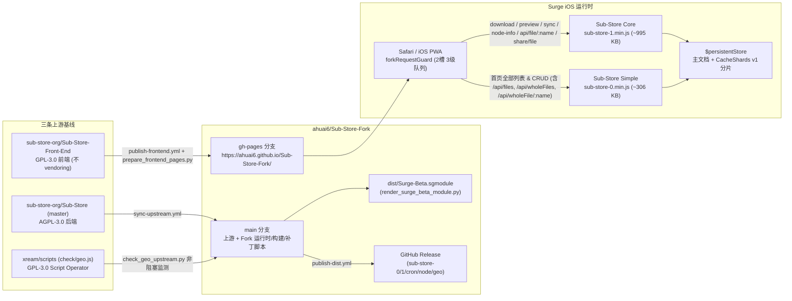

# Sub-Store-Fork 技术架构与子系统规范

本文是 `AGENTS.md` 的技术架构深潜文档，详细记录本仓库的目录边界、Surge 路由拆分、打包瘦身、热路径优化、存储分片、全局 TTL、非 Node 路由与日志、前端 Pages 补丁体系、`geo.js` Script Operator 以及定时任务/模块渲染规范。

> 核心硬性约束与审批边界见根目录 `AGENTS.md`；三上游同步、CI/CD 与冲突解决流程见 `docs/fork-maintenance.md`；历史演进与实测数据见 `docs/maintenance-log.md`。

---

## 1. 系统全景与三上游数据流



---

## 2. 目录结构与代码边界

| 路径 | 职责与修改边界 |
| --- | --- |
| `backend/` | pnpm 包（`packageManager: pnpm@11.0.9`，Node 版本钉在根目录 `.node-version`）。`package.json` 的 `version` 即 Release tag |
| `backend/src/main.js` | Node 入口，经 `backend/src/restful/index.js` 注册全部路由 |
| `backend/src/products/sub-store-0.js` | **Surge 简单脚本**：collections、subscriptions、tokens、modules、纯文件元数据（`file-metadata.js`）、artifacts、settings、sort、archives、miscs、logs、age。**严禁导入 `ProxyUtils`、`restful/sync.js`、`restful/file.js`** |
| `backend/src/products/sub-store-1.js` | **Surge 核心脚本**：download、完整 `file.js`（`/api/file/:name`、`/share/file/:name` 及旧模块兼容）、preview、sync、node-info。保留全部解析器与生产者 |
| `backend/src/products/cron-sync-artifacts.js` | 定时同步（Gist）、定时处理（produce）、输出缓存预热（prefetch） |
| `backend/src/products/resource-parser.loon.js`、`proxy-utils.esm.js` | 非 Surge 主路径产物；源码与构建均保留 |
| `backend/src/restful/file-metadata.js` | Fork 新增的纯文件元数据路由（`/api/files`、`/api/wholeFiles`、`/api/wholeFile/:name`），零 `ProxyUtils` 依赖，注册阶段不写 `FILES_KEY` |
| `backend/bundle-esbuild.js`、`backend/surge-only-strip.js` | 打包入口与三个零侵入瘦身插件（`surgeOnlyStripPlugin`、`stripPeggyGrammarPlugin`、`dedupeNoblePlugin`）及构建断言 |
| `backend/scripts/precompile-peggy.js`、`backend/scripts/bench.js` | Peggy 预编译（输出到 `.gitignore` 的 `parsers/peggy/generated/`）与 V8 性能基准（基线 `backend/bench/baseline.json`） |
| `config/Surge-Beta.sgmodule` | **上游原文件，禁止直接编辑** |
| `dist/Surge-Beta.sgmodule` | 由 `.github/scripts/render_surge_beta_module.py` 生成的公开模块，必须与渲染器输出逐字节一致 |
| `scripts/check/geo.js`、`GEO-NOTICE.md`、`GEO-LICENSE.txt` | 发布的 `geo.js` Script Operator 及其 GPL-3.0 许可证与上游 blob SHA 追踪说明 |
| `backend/src/test/fixtures/geo.upstream.js` | 上游 `xream/scripts` `geo.js` 快照，供 `geo-optimized.spec.js` 对比默认行为一致性 |
| `.github/scripts/` | 维护、检查、补丁与发布脚本及对应 Python 单元测试（`test_*.py`） |
| `.github/scripts/fork-frontend/forkRequestGuard.ts` | 构建前端时注入 `src/utils/forkRequestGuard.ts` 的 Surge 会话保护与优先级队列模块 |
| `.github/workflows/` | `ci.yml`、`sync-upstream.yml`、`publish-dist.yml`、`publish-frontend.yml`；`main.yml` 和 `star-history.yml` 为上游原文件，不动 |

---

## 3. Surge 路由拆分规范

Surge `[Script]` 按**声明顺序**匹配 URL `pattern`（注意：**Surge `pattern` 只匹配 URL，不区分 HTTP 方法**）。公开模块将 `Sub-Store Core`（`sub-store-1.min.js`）排在 `Sub-Store Simple`（`sub-store-0.min.js`）之前：

- **Core (`sub-store-1.min.js`)** 匹配规则（`FORK_CORE_PATTERN`）：
  ```text
  ^https?:\/\/sub\.store\/((download)|share\/file(?:\/|\?|#|$)|api\/(file(?:\/|\?|#|$)|preview|sync|(?:utils\/node-info)))
  ```
  承接需要 `ProxyUtils` / `produceArtifact` / 重型下载的路由：`/download/*`、`/share/file/*`、`/api/file/:name`（GET/PATCH/DELETE）、`/api/preview/*`、`/api/sync/*`、`/api/utils/node-info`。
- **Simple (`sub-store-0.min.js`)** 匹配规则：`^https?:\/\/sub\.store` 兜底。
  承接 Web UI 首页与日常管理全部轻请求：`/api/subs`、`/api/collections`、`/api/wholeFiles`、`/api/files`、`/api/wholeFile/:name`、`/api/artifacts`、`/api/settings`、`/api/utils/env`、`/api/utils/refresh`、`/api/logs`、`/api/tokens`、`/api/modules`、`/api/archives`、`/api/sort/*`、`/api/age/*`、`/`（302 重定向到 Pages 前端）。
- **向后兼容**：`sub-store-1.min.js` 依然注册完整 `restful/file.js`，未更新模块的旧 Surge 安装不受任何影响。
- **冷启动零写入约束**：`sub-store-0.js` 注册的所有路由模块不得在 `register($app)` 阶段对缺失键执行 `$.write(...)`（例如 `file-metadata.js` 仅在 `POST /api/files` 内懒初始化 `FILES_KEY`），确保简单请求不会触发整份 `sub-store` 主文档重写。

---

## 4. Surge-only 构建与零源码侵入瘦身

### 4.1 编译期常量与区域剥离

仅 `sub-store-0.min.js` 和 `sub-store-1.min.js` 启用 Surge-only `define`：

```text
__SURGE_ONLY__ = true
$platform = "Surge"
```

- `backend/src/runtime/build-flags.js` 将上述标识折为常量，使 esbuild 静态剪枝非 Surge 分支。
- 其他产物定义 `__SURGE_ONLY__ = false`，测试与 `babel-node` 不定义，保持动态宿主检测。**严禁给 `$platform` 赋值**（Surge 构建会将其替换为字符串字面量）。
- `backend/surge-only-strip.js` 在解析前剔除 `/* @non-surge-start */` … `/* @non-surge-end */` 整段语句（必须成对、包住完整语句、禁止嵌套）。

### 4.2 两个零源码侵入 esbuild 插件（`backend/bundle-esbuild.js`）

全部浏览器产物（含 Surge、Loon、cron、Node 入口、ESM）均启用：

1. **`stripPeggyGrammarPlugin`**：
   - `parsers/peggy/(surge|loon|qx).js` 中的 `export const grammars = String.raw\`...\`;` 仅在构建期供 `precompile-peggy.js` 与单测使用；因 `String.raw` 标签调用被 esbuild 视为可能有副作用而未被 tree-shake。
   - 插件在打包加载阶段将 `export const grammars = String.raw\`[\s\S]*?\r?\n\`;` 替换为 `export const grammars = '';`（若未命中则直接抛错），保留上游源文件原样不变，省去 ~58 KB 运行时死代码。
2. **`dedupeNoblePlugin`**：
   - 上游依赖中 `age-encryption` 使用 `@noble/curves@2.2.0` / `@noble/hashes@2.2.0`，而 `@noble/post-quantum` 声明 `~2.0.0`，导致 pnpm 虚拟存储中存在两套副本被重复打进包内。
   - 插件在 `onResolve` 阶段将 `^@noble/(curves|hashes)(/|$)` 统一经 `age-encryption` 的真实目录解析至单一 2.2.0 副本，不修改上游 `package.json` 或 `pnpm-lock.yaml`，省去 ~30–60 KB 重复加密代码。

### 4.3 构建期断言（无脆性字节门槛）

`bundle-esbuild.js` 打包结束后执行 `assertNobleDeduplicated()` 与 `assertSurgeOnlyBundles()`：
- 所有浏览器 metafile 中 `@noble/curves` 与 `@noble/hashes` 各自不得超过 1 个版本。
- `sub-store-0.min.js` 禁止出现 `ProxyUtils` 及 `undici`、`shoutrrr`、`dotenv`、`geoip2`、`fetch-socks`、`require("express")`、`require("body-parser")`、`$task.fetch`、`$prefs`、`stash-version`、`KJUR`、`// global initializer`、`// per-parser initializer`；必须保留 `policy-descriptor`、`lodash`、`$httpClient`、`$persistentStore`。
- `sub-store-1.min.js` 禁止出现上述非 Surge 宿主适配器与 Peggy 原始语法注释；必须保留 `sing-box`、`vmess` 及全部生产者/解析器。
- Node 产物 `sub-store.min.js` 必须保留 `undici`、`dotenv`、`shoutrrr-ts` 动态边界；`sub-store.bundle.js` 必须保留 `undici` 与 `shoutrrr-ts`。

---

## 5. 热路径、下载与输出缓存流水线

1. **国旗匹配（`backend/src/utils/geo.js`）**：`getFlag` 的关键词匹配器、国旗表与 ISO 表在模块作用域编译一次，不再按节点重建。
2. **Peggy 预编译（`backend/scripts/precompile-peggy.js`）**：`pretest`、`prebench`、`prebundle:esbuild`、`prestart` 时将 `surge.js`、`loon.js`、`qx.js` 中的语法编译到 `parsers/peggy/generated/`（已 `.gitignore`）。运行时 `getParser()` 直接加载预编译结果，绝不调用 `peggy.generate`。语法变更后重新运行预编译，不要手改生成文件。
3. **下载与输出缓存去重解析（`download.js`、`sync.js`、`preview.js`）**：
   - **缓存命中零解析**：非 `raw` 模式下，`sync.js` 与 `preview.js` 调用 `download(..., { returnRaw: true, deferPreprocess: true, returnParsed: true })`。当命中 `resourceCache` / `customCache` / `tasks` 时，`finalizeDownloadedBody` 跳过 `clashPreprocessor` 与 `ProxyUtils.parse`；若随后命中 `outputCache`，全程 **0 次** YAML 与代理节点解析。
   - **网络冷拉单次解析**：未命中资源缓存走 HTTP 拉取时，`finalizeDownloadedBody` 仍执行节点有效性校验（确保空/损坏响应不入缓存），同时通过 `returnParsed: true` 将校验阶段解析出的 `proxies` 数组传回 `sync.js` / `preview.js`，经 `parseRawProxyEntries` 直接复用（`mergeSources` 合并的本地段以 `null` 占位对齐），避免同一订阅单次拉取解析两次。
   - **流量头缓存回填**：`download.js` 从下载响应头提取到 `subscription-userinfo` 时，若未使用自定义 `headers`、`flowUserAgent`、`flowUrl`、`flowHeaders`，会额外按 `hex_md5(defaultFlowUserAgent + originalUrl)` 回填 `headersResourceCache`（遵循 `headersCacheTtl`，TTL 为 0 时不写），避免自定义 UA 或启用 `githubProxy` 后 `/api/sub/flow` 重复发起 HEAD/GET 请求。
4. **输出缓存键优化（`backend/src/utils/output-cache.js`）**：
   - `OMITTED_SETTINGS` 排除不影响节点输出的配置项（`syncTime`、`syncPlatform`、`githubUser`、`githubApiUrl`、`githubApiTimeout`、`artifactSyncBatchSize`、`gistUpload`、`gistDownloadTokenStrategy`、`avatarUrl`、`artifactStore`、`artifactStoreStatus`、`theme`、`appearanceSetting`、`logsMaxCount`、`backendRequestConcurrency`、`backendRequestConcurrencyWaitTime`）。
   - 超 256 字符的原始订阅文本先通过 `digestLargeString` 转为 `md5:<len>:<hex>` 再构造键，降低键构造时的内存拷贝峰值。
   - `noCache`、`noOutputCache`、`settings.outputCache` 为 false/0/off，以及组合订阅中任意子订阅启用 `noCache` 时均跳过输出缓存。命中输出缓存后，响应转换器与 age 加密仍按当次请求执行。
5. **同进程并发去重（`backend/src/utils/inflight.js`）**：preview、download、node-info 在同一 JS realm 内共享进行中的 Promise（Node 进程并发请求有效；Surge 每次 http-request 独立冷启动、`$done()` 退出，**不跨脚本会话，不加持久锁**）。

---

## 6. 存储、O(1) 缓存分片与全局 TTL

### 6.1 主文档持久化（`backend/src/vendor/open-api.js`）

- Node 模式下每个顶层 cache 名为独立 pretty JSON 文件（`SUB_STORE_DATA_BASE_PATH` 或 `.` 下的 `${name}.json`），`#` 开头键写入 `root.json`；仅重写实际变化的文件，内容相同则跳过。
- Surge 模式下主文档为紧凑 JSON（`JSON.stringify` 无缩进），内容与上次读取相同时跳过 `$persistentStore.write`；不做延迟防抖（脚本在 `$done()` 即销毁）。
- 恢复备份（`POST /api/storage`）在 Surge 下同步刷新内存 cache 并立即执行 `migrate()`。

### 6.2 全局 TTL 规则（`backend/src/utils/bounded-cache.js`）

设置项单位为**秒**，内部 `DEFAULT_*` 为**毫秒**。`ttlFromSetting` 规则：
- 键不存在：使用默认毫秒数。
- 键存在且数值 `> 0`：`秒 × 1000`。
- 键存在且数值 `<= 0` 或非有限数：返回 `0`（**禁用读写**）。缩短 TTL 后，已有条目有效期会被 `created + 当前 TTL` 截断（cap）。

| 设置键 | 默认值 | 管控范围 |
| --- | --- | --- |
| `resourceCacheTtl` | 1 小时（`DEFAULT_CACHE_TTL`） | 原始资源缓存（`#sub-store-cached-resource`）、订阅/集合/预览输出缓存（`#sub-store-cached-output`） |
| `headersCacheTtl` | 1 分钟（`DEFAULT_HEADERS_CACHE_TTL`） | 响应头与流量信息（`#sub-store-cached-headers-resource`） |
| `scriptCacheTtl` | 48 小时（`DEFAULT_SCRIPT_CACHE_TTL`） | 脚本资源缓存（`#sub-store-cached-script-resource`）、`geo.js` `cache`、共享节点检测（`#sub-store-cached-check`） |

`PATCH /api/settings` 对上述三个 TTL 键的保存规则（兼容前端 `My.vue` 的 `nut-input` 字符串模型与 `settings.ts` 的 `value || ""` 读回）：
- 数字 `0` 存 `0`；字符串 `"0"` / `"0.0"` / `" 0 "` 存 `"0"`（确保前端显示 `"0"` 且 `Number("0") === 0` 关闭缓存）。
- 负数按提交类型收成 `0` 或 `"0"`。
- `null`、空串、纯空白、非数字（含 `NaN`、`Infinity`）删除该键以恢复默认（必须在转数字前识别空值，因为 `Number("") === 0`）。
- 正数保持原类型；本次 patch 未携带的键保持原值。
- `defaultTimeout`、`githubApiTimeout`、`artifactSyncBatchSize`、`cacheThreshold` 仍保持非正数/非数字即删键。

### 6.3 缓存分片布局与 O(1) 增量路径（`backend/src/utils/cache-shards.js`）

六个缓存存储键中，除体量极小的 `#sub-store-cached-headers-resource` 外，其余五个（`#sub-store-cached-resource`、`#sub-store-cached-script-resource`、`#sub-store-cached-output`、`#sub-store-cached-check`、`#sub-store-cached-last-good`）全部接入 `CacheShards`：

- **阈值与格式**：整份映射序列化 `<= 64 KiB` 保持旧单值 JSON 对象布局；超过 `64 KiB` 迁至 `cacheShardsVersion: 1` manifest，每条记录独立存于 `` `${storeKey}:v1:${md5(id)}` ``。
- **单值上限**：`SHARD_BYTES = 3 MiB`（复用单例 `TextEncoder` 计算 UTF-8 字节，含外层 `[id, entry]` 包装）；超限单条直接跳过不拆块，规避 iOS 约 4 MB 单值限制。
- **冷启动懒读与 O(1) 增量写/删**：
  - `readEntry(id)`：冷启动只读 manifest + 目标单个分片，不加载其余分片。
  - `writeEntries(map)` / `deleteEntries(ids)`：已分片状态下新增/修改/过期删除仅读写受影响的单个分片；覆写已有键时键集合未变，**0 次 manifest 重写**；新增键采用 manifest-first 顺序防孤儿分片；旧布局或异常时自动回退全量 `save()`。
- **一键清理**：`/api/utils/refresh` 调用全部缓存的 `revokeAll()`，按 manifest 清除所有已登记分片并将主键置 `{}`；`scriptResourceCache.revokeAll()` 联动清理 `checkResultCache` 与 `lastGoodCache`。

---

## 7. 非 Node 路由（`vendor/express.js`）与调试日志（`debug-logs.js`）

- **`backend/src/vendor/express.js`（非 Node 宿主适配器）**：
  - 修复 `METHODS_NAMES` 中 `"HEAD'"` 拼写错误及 `next()` 传参错误（改为 `dispatch(request, matchedIndex + 1)`）。
  - `Content-Type` 含 `json` 时在 CORS 检查之后解析：空体/null 转 `{}`，非法 JSON 直接返回 HTTP 400（`INVALID_JSON`，附带 CORS 响应头），不再崩溃挂死 Surge。
  - 统一 `try { const ret = cb(...); if (ret?.then) ret.catch(errFunc); } catch (err) { errFunc(err); }`，同时兜底同步抛错与非 `async` 函数返回的 Promise 拒绝。
  - `Response.set` / `Response.removeHeader` 大小写不敏感去重，避免同时输出 `Content-Type` 与 `content-type`。
  - `extractURL` 按首个 `=` 切分保留含 `=` 的参数值、去除 `#hash`、安全 `decodeURIComponent`（非法 `%ZZ` 不抛 `URIError`）、无值键存 `""` 与 Node Express 对齐。
  - `Response.send()` 在 `$done()` 之前自动调用 `scriptResourceCache.flush()` 与 `flushLogEntries($)`。
- **`backend/src/utils/debug-logs.js`**：
  - `logsMaxCount` 默认 `0`（零 I/O）。
  - 开启日志后，在 `SURGE_ONLY` 模式下批量缓冲于内存，每满 50 条或在 `Response.send()` / `$.done` / `getLogEntries()` 时合并落盘一次，避免单次请求反复读写整份 `#sub-store-logs`。
  - Node 与测试环境（`SURGE_ONLY === false`）保持即时落盘，完全兼容上游 `logs.spec.js`（含 `env: { isNode: false }` 断言）。

---

## 8. 前端 GitHub Pages 补丁体系

本仓库不 vendoring 前端代码。`publish-frontend.yml` 每日构建上游 `sub-store-org/Sub-Store-Front-End` 时调用 `.github/scripts/prepare_frontend_pages.py --patch`（锚点缺失立即失败，绝不静默跳过）：

- **当前补丁戳**：`PATCH_STAMP = "subpath-routes-2-pwa-autoupdate-1-surge-session-3-repo-pages-1"`
- **构建配置与子路径修复**：
  - Vite `base` / `VITE_PUBLIC_PATH` = `/Sub-Store-Fork/`（拒绝 `/`），`VITE_API_URL = https://sub.store`。
  - `createWebHistory(import.meta.env.BASE_URL)`；`index.html` 与 `public/manifests.json` 根路径重写；复制 `404.html` 与 `.nojekyll` 支撑 SPA 路由。
  - `src/store/subs.ts` 的 `canFetchFlowsForCurrentPage` 剥离 `BASE_URL` 后再比对 `/subs`。
  - 加载失败页的 `<a href="/aboutUs">` 替换为 `<router-link to="/aboutUs">`。
  - `APISetting.vue` 复制链接改为 `new URL(import.meta.env.BASE_URL, window.location.origin)`。
  - `src/components/PreviewPanel.vue` 的 `buildUrlWithQuery('/preview', ...)` 改为拼接 `import.meta.env.BASE_URL`，修复原始文本预览 404。
- **PWA 自动更新**：
  - `vite.config.ts` 中 `registerType` 从 `"prompt"` 改为 `"autoUpdate"`，`navigateFallback` 改为 `"index.html"`；`check_dist` 强制断言 `dist/sw.js` 含 `skipWaiting` 与 `clientsClaim`，避免 iOS PWA 永久停留在旧 waiting worker。
- **Surge 会话保护与 3 级优先级队列（`.github/scripts/fork-frontend/forkRequestGuard.ts`）**：
  - Surge Webview 上限 3 个并发脚本会话；全局将 API 并发封顶为 **2**（`sub-store-fork-api-cap:2`），留 1 槽余量。
  - 3 级优先级：Priority 2（写操作 `POST/PUT/PATCH/DELETE` 及 `/api/preview/`、`/api/sync/`、`/api/utils/(refresh|backup)`、`/api/storage`、`/api/sort/`、`/api/age/`、`/api/file/`、`/download/`、`/share/`） > Priority 1（常规列表与配置读取） > Priority 0（`/api/sub/flow`）。
  - 页面处于 `document.visibilityState === 'hidden'` 时暂停启动排队中的 Priority-0 流量请求，回到前台通过 `visibilitychange` 恢复，期间中断/取消仍立即清理不漏槽。
  - `src/views/FilePreview.vue` 的原始 `axios.get` 改为 `queuedPreviewGet(axios, ...)`，共享 2 槽队列（Priority 2）并应用 `localStorage.apiRequestTimeout`（默认 50000 ms）；注意返回类型声明为 `Promise<any>` 以兼容上游 `vue-tsc`。
  - 刷新/前进后退/bfcache 恢复后的页面阻止自动发起 `POST /api/preview/*`，直至下次用户交互（`sub-store-fork-skip-restored-preview`）。
- **连接预热与渲染性能**：
  - `index.html` 注入 `<meta name="sub-store-fork" content="api-cap-2 skip-restored-preview" />`、`<link rel="preconnect" href="https://sub.store" crossorigin />`，以及 `.compare-table-body .compare-table-row{content-visibility:auto;contain-intrinsic-size:auto 56px;}` 加速数千节点对比表渲染。

---

## 9. `geo.js` Script Operator 架构

源码位于 `scripts/check/geo.js`，公开地址 `https://raw.githubusercontent.com/ahuai6/Sub-Store-Fork/main/scripts/check/geo.js`。作为 Sub-Store Script Operator 使用，向后兼容上游 `xream/scripts` 全部参数与模板，所有增强参数默认关闭。

| 参数 | 默认值 | 行为说明 |
| --- | --- | --- |
| `cache` | false | 仅当 `scriptCacheTtl > 0` 时读写 TTL 缓存；启用后先执行**同步预扫描**，将命中本地/共享缓存的节点先行渲染，把 `time_budget` 全部留给未缓存网络探测 |
| `concurrency` | 10 | 超过 20 按 20 封顶（Surge `$httpClient` 上限） |
| `timeout` | 5000 | 单次请求超时（毫秒） |
| `two_phase` | false | 先向 `reachability_url`（默认 `http://www.gstatic.com/generate_204`）做可达性探测（`reachability_timeout` 默认 1500 ms、上限 5000 ms、不重试），通过后再请求 geo |
| `dedup_target` | false | 单次调用内按 `server + port + type` 共享进行中的请求（注意：不同凭据可能出口不同，仅作 opt-in） |
| `time_budget` | 关闭（安全上限 880000 ms） | 毫秒；用尽后不再启动新节点，未启动节点保留原名且不写失败缓存；留足余量防触发 Surge 900 s 脚本超时 |
| `keep_last` | false | 失败、超时或被 `time_budget` 跳过时沿用该节点上次成功结果（存 `#sub-store-cached-last-good`，键同 `cacheId`，不受 `scriptCacheTtl` 过期，输出不打标记，刷新/清缓存时一起清除） |
| `keep_last_max_age` | 不限 | 纯数字为毫秒，也支持 `3600s`、`24h`、`7d`；省略/空/0 表示保留至下次成功或清缓存 |
| `prioritize_stale` | false | 配合 `keep_last=true` 使用：将未命中缓存的探测任务按「从未成功优先，其次 `savedAt` 最早」排序，不改变返回数组顺序 |

- 写入策略：TTL 缓存与 `lastGood` 均按 25 条或 15 秒周期批量刷盘，并在 `finally` 中收尾落盘。
- 可观测性：每次运行结束经 `$.info` 输出单行汇总 `[geo] total=... cache=... shared=... ok=... failed=... keepLast=... budgetSkipped=... incompatible=... elapsed=...ms`。
- 推荐组合：`cache=true&two_phase=true&time_budget=40000&keep_last=true&keep_last_max_age=7d&prioritize_stale=true`（注意 `time_budget` 应小于前端 `apiRequestTimeout`，或调大前端超时）。

---

## 10. 定时任务与模块渲染（`render_surge_beta_module.py`）

- `config/Surge-Beta.sgmodule` 始终保持与上游一致；`.github/scripts/render_surge_beta_module.py` 套用 5 项可逆变换并校验可逐字节还原为上游文件：
  1. 将脚本 URL 前缀从 `sub-store-org/Sub-Store` 替换为 `ahuai6/Sub-Store-Fork`；
  2. 在 `cors` 默认值追加 `https://ahuai6.github.io`；
  3. 将 `sync:"Sub-Store Sync"` 改为 `sync:"# Sub-Store Sync"`（上游 `produce` 已带 `#`）；
  4. 调整 `Sub-Store Core` 的 `pattern`（加入 `share/file` 与 `api/file/`，同时保持 `/api/files`、`/api/wholeFiles`、`/api/wholeFile/:name` 走 Simple）；
  5. 追加默认关闭的 `prefetch` 定时任务及全非空默认参数：`prefetch:"# Sub-Store Prefetch"`、`prefetch_cron:"50 */6 * * *"`、`prefetch_sub:off`、`prefetch_col:off`、`prefetch_platform:Surge`。
- `backend/src/utils/prefetch-cron.js`：若 `prefetch` 启用但 `prefetch_cron` 为空，直接返回不生成也不落入 Gist 同步；`off` 表示不选目标，真正叫 `off` 的订阅可写 `%6Fff`（过滤关闭值后再 URL 解码）；预热结果写入输出缓存，同样遵循 `resourceCacheTtl`。
